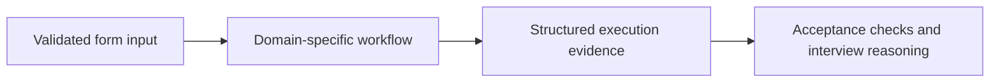

# Implementation walkthrough
## Problem and design
Route a failed primary operation to a declared fallback while preserving the failure reason.

The main concept is fallback routing without hiding failure. When would returning stale fallback guidance be worse than failing the request?

## Imports and configuration
`Path` locates local files; `contextmanager` closes database handles; datetime utilities represent UTC timestamps; json parses evidence; math validates finite measurements; os reads configuration names; re handles explicit lexical processing; sqlite3 stores transactional state; uuid creates identifiers; hashlib supports integrity hashes; time measures execution duration; streamlit renders the interface; load_dotenv loads optional local configuration without replacing existing variables.

StateGraph defines computation; START/END bound its flow; TypedDict documents state fields; Annotated reducers define concurrent merging; Command/Send represent routing and fan-out; interrupt pauses execution; savers define checkpoint lifetime; message classes preserve role and identity; add_messages merges messages by ID.

Additional imports in this core: none.

## Input fields
| Field | Local value type | Prepared example |
|---|---|---|
| primary_available | bool | `false` |
| request | str | `"Get a response"` |

## Data flow


## Complete experiment core
```python
class State(TypedDict):request:str;primary_available:bool;error:str;answer:str;path:str

def run(data):
    request=text(data['request'],2000);available=data['primary_available']
    if type(available) is not bool:raise ValueError('Availability must be boolean.')
    builder=StateGraph(State)
    builder.add_node('primary',lambda s:{'answer':'Primary: '+s['request'],'path':'primary','error':''} if s['primary_available'] else {'error':'Primary unavailable','path':'fallback'})
    builder.add_node('fallback',lambda s:{'answer':'Cached guidance: retry later; no fresh provider response is available.'})
    builder.add_edge(START,'primary');builder.add_conditional_edges('primary',lambda s:'fallback' if s['error'] else END,{'fallback':'fallback',END:END});builder.add_edge('fallback',END);graph=builder.compile()
    return evidence(graph,graph.invoke({'request':request,'primary_available':available}))
```

## Read the important operations
The `run` function is the local application contract. Validation happens before execution. Returned fields are deliberately exposed so the learner can inspect intermediate state, identifiers, and failure behavior rather than infer success from a badge. Where a graph is used, nodes return partial state updates and edges define when the next stage executes. Where records are analyzed, finite-number and schema checks prevent silent metric corruption.

## Reliability and performance
The UI batches fields into a single form submission, clears stale evidence on failure, and renders user text through native widgets. Database contexts commit or roll back and close their connections. Input arrays and text have explicit limits. Complexity follows the supplied records and graph steps; avoid extrapolating small local timings to production capacity. A transaction protects local consistency but does not provide multi-region durability. Review limits in the core before increasing data volumes.

## Architectural boundary
Local deterministic workflow; model intelligence and managed deployment are separate concerns. Interviews should distinguish an implemented property from a property that would require a different backend, identity provider, service account, load test, or deployment.
