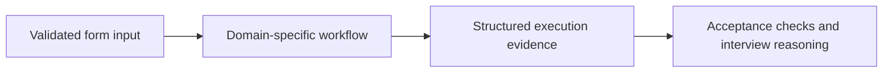

# Implementation walkthrough
## Problem and design
Persist work between graph steps and advance a batch one unit at a time.

The main concept is durable stepwise execution. How do stable job IDs and replay-safe units make restart recovery possible?

## Imports and configuration
`Path` locates local files; `contextmanager` closes database handles; datetime utilities represent UTC timestamps; json parses evidence; math validates finite measurements; os reads configuration names; re handles explicit lexical processing; sqlite3 stores transactional state; uuid creates identifiers; hashlib supports integrity hashes; time measures execution duration; streamlit renders the interface; load_dotenv loads optional local configuration without replacing existing variables.

StateGraph defines computation; START/END bound its flow; TypedDict documents state fields; Annotated reducers define concurrent merging; Command/Send represent routing and fan-out; interrupt pauses execution; savers define checkpoint lifetime; message classes preserve role and identity; add_messages merges messages by ID.

Additional imports in this core: none.

## Input fields
| Field | Local value type | Prepared example |
|---|---|---|
| job | str | `"job-demo"` |
| action | str | `"start"` |
| work | list | `["collect", "evaluate", "report"]` |

## Data flow


## Complete experiment core
```python
class Job(TypedDict):work:list[str];cursor:int;completed:list[str]
def build(saver):
    builder=StateGraph(Job)
    builder.add_node('process',lambda s:{'cursor':s['cursor']+1,'completed':s['completed']+[s['work'][s['cursor']].upper()]})
    builder.add_edge(START,'process');builder.add_conditional_edges('process',lambda s:'process' if s['cursor']<len(s['work']) else END,{'process':'process',END:END})
    return builder.compile(checkpointer=saver,interrupt_before=['process'])
def run(data):
    job=text(data['job'],80);action=data['action'];work=[text(x,200) for x in items(data['work'],20)]
    if action not in ('start','continue'):raise ValueError('Choose start or continue.')
    DATA_DIR.mkdir(parents=True,exist_ok=True);config={'configurable':{'thread_id':job}}
    with SqliteSaver.from_conn_string(str(DATA_DIR/'jobs.sqlite')) as saver:
        graph=build(saver);snapshot=graph.get_state(config)
        if action=='start':
            if snapshot.values:raise ValueError('Job exists; use continue or a new ID.')
            result=graph.invoke({'work':work,'cursor':0,'completed':[]},config)
        else:
            if not snapshot.values:raise ValueError('Start this job first.')
            result=graph.invoke(None,config) if snapshot.next else snapshot.values
        return evidence(graph,{**result,'pending':bool(graph.get_state(config).next)})
```

## Read the important operations
The `run` function is the local application contract. Validation happens before execution. Returned fields are deliberately exposed so the learner can inspect intermediate state, identifiers, and failure behavior rather than infer success from a badge. Where a graph is used, nodes return partial state updates and edges define when the next stage executes. Where records are analyzed, finite-number and schema checks prevent silent metric corruption.

## Reliability and performance
The UI batches fields into a single form submission, clears stale evidence on failure, and renders user text through native widgets. Database contexts commit or roll back and close their connections. Input arrays and text have explicit limits. Complexity follows the supplied records and graph steps; avoid extrapolating small local timings to production capacity. A transaction protects local consistency but does not provide multi-region durability. Review limits in the core before increasing data volumes.

## Architectural boundary
Local deterministic workflow; model intelligence and managed deployment are separate concerns. Interviews should distinguish an implemented property from a property that would require a different backend, identity provider, service account, load test, or deployment.
